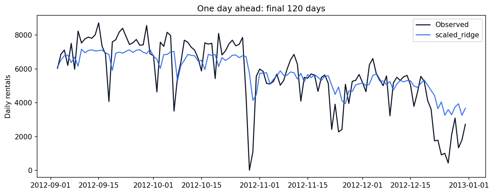
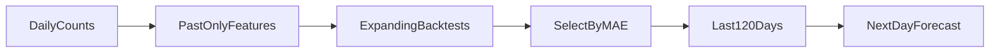

<p align="center"></p>

# Bike Demand Forecasting

**Forecast tomorrow with information available today.**

[](https://github.com/Djordje3002/bike-demand-forecasting/actions/workflows/ci.yml)


Forecast the next day's total bike rentals using historical demand and known calendar information. This models an operational planning question: how much demand should a bike-sharing operator prepare for tomorrow after today's demand is observed?

**Project 3/6 · Intermediate+** in the [Machine Learning Portfolio](https://github.com/Djordje3002/ml-portfolio).

## What this project demonstrates

lag features · rolling windows · expanding backtests · seasonal baselines · forecasting.

Working training and prediction commands, real benchmark data, baseline comparisons, committed measured reports, an experiment-review notebook, regression tests and CI. This is a reproducible portfolio experiment; results describe the stated benchmark protocol.

## Measured results

| Model | mae | rmse | r2 |
| --- | ---: | ---: | ---: |
| `seasonal_naive` | 1342.2667 | 1911.1827 | 0.0640 |
| `scaled_ridge` | 931.6062 | 1298.9894 | 0.5676 |
| `hist_gradient_boosting` | 1382.2933 | 1878.0498 | 0.0961 |


**Selected using training CV or validation:** `scaled_ridge`. The tables report test results; selection is never changed to favor the test winner.

Ridge wins the backtests and reduces test MAE from 1,342 to 932 rentals/day versus the seven-day baseline. The boosted trees generalize worse in this setup. This is a sequence of one-day-ahead predictions with actual past counts, not a 120-day forecast made at one origin. The difficult late-2012 period remains visible in the chart.



Full precision, split counts, package versions and source provenance are in [metrics.json](reports/metrics.json). The committed run used Python 3.11 on macOS with seed 42. Results can vary slightly across platforms and dependency versions. These numbers are benchmark measurements, not production performance promises.

## Run locally

Use Python 3.11 or 3.12 and run commands from the repository root. No API key, paid service or GPU is required. The first training run downloads the small source archive; subsequent runs verify and reuse the local cache. The digits project uses scikit-learn's bundled dataset instead.

```bash
git clone https://github.com/Djordje3002/bike-demand-forecasting.git
cd bike-demand-forecasting
python3.11 -m venv .venv
source .venv/bin/activate
python -m pip install -e ".[dev]"
python -m bike_forecast train
python -m bike_forecast predict --input examples/sample.json
python -m pytest -q
```

On Windows, activate with `.venv\Scripts\activate`. A Python 3.12 installation can replace `python3.11` in the setup command. Start with a few minutes of CPU time; training time depends on your machine, with the CNN and factorization requiring more work than the small tabular examples.

Training writes local models to `artifacts/` and refreshes `reports/`. Datasets and trained binaries are excluded from Git. The example JSON is an input contract, and predictions are calculated from the locally trained model.

## Experiment design



The first 28 days supply lag history, leaving 703 feature rows. The final 120 days are reserved for testing. Four expanding-window folds, each with a 60-day validation window, select among scaled ridge, histogram gradient boosting and a seven-day seasonal-naive baseline. Lags use shifts of 1, 7, 14 and 28 days; rolling averages use `shift(1)` before rolling. The final fitted model remains fixed during testing. Predictions for each next day may use all counts observed by the preceding day, including earlier test days.

### Data provenance

UCI Bike Sharing daily file: 731 observations from Washington, D.C. in 2011–2012. Target: daily count `cnt`. Same-day `casual` and `registered` sum to the target and are deliberately excluded. Actual target-day weather is excluded because it is unavailable at forecast time; holiday status is assumed known.

Source: [Bike Demand Forecasting dataset](https://archive.ics.uci.edu/dataset/275/bike+sharing+dataset). See [Data card](docs/DATA_CARD.md) for attribution, integrity and usage terms.

## Explore the evidence

- [Experiment review notebook](notebooks/01_review_results.ipynb): inspect the committed metrics, compare models and view the actual evaluation chart.
- [Model card](docs/MODEL_CARD.md): intended use, evaluation boundary and failure modes.
- [Experiment protocol](docs/EXPERIMENTS.md): reproduction steps and selection rules.
- [Prediction input](examples/sample.json): a complete example for the command-line interface.

`examples/sample.json` provides 28 manually constructed historical counts, oldest first, plus tomorrow's date and holiday flag. These example counts are illustrative inputs, not an additional benchmark dataset.

## Repository structure

```text
src/bike_forecast/       Training, prediction and integrity helpers
tests/                   Offline regression and contract tests
data/source.json         Source URL and expected SHA-256 (downloaded datasets)
data/raw/                Local verified dataset cache; ignored by Git
examples/                Ready-to-run prediction inputs
notebooks/               Executed experiment review
reports/                 Measured metrics and evaluation plots
docs/                    Data card, model card and experiment protocol
artifacts/               Locally trained models; ignored by Git
.github/workflows/       Lint, tests and full benchmark training
```

## Quality checks

```bash
make check test
make train
```

Changing future targets cannot alter earlier features; rolling windows end yesterday; seasonal lags use the correct day; target components and actual weather are absent; inference rejects wrong-length, negative and non-finite histories.

CI repeats lint, formatting, tests and the complete training/evaluation command on Linux, then uploads reports for inspection. Training requires network access only on a cache miss. Offline tests use small constructed fixtures rather than substitute benchmark data.

## Limits and responsible interpretation

Only two years from one city are available. Growth, unusual weather, closures and holidays create distribution changes. No weather-forecast archive is used. Linear trend extrapolation can become implausible far outside the training period; the sample 2013 date demonstrates the interface, not present-day demand. A multi-day recursive forecast requires a different evaluation design.

## License and attribution

Code is [MIT licensed](LICENSE). Dataset rights are separate; see [Data card](docs/DATA_CARD.md). Built with Python and the libraries listed in [pyproject.toml](pyproject.toml).

**Dataset citation:** Fanaee-T, H. (2013). Bike Sharing. UCI Machine Learning Repository. https://doi.org/10.24432/C5W894

Created by [Djordje Kartaljevic](https://github.com/Djordje3002). [Explore the full progression →](https://github.com/Djordje3002/ml-portfolio)
